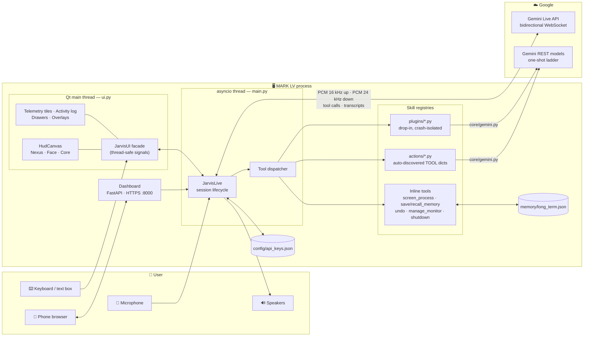
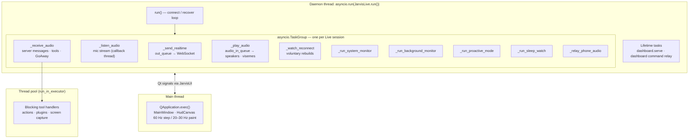
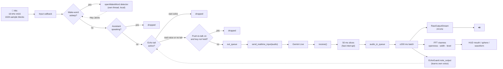
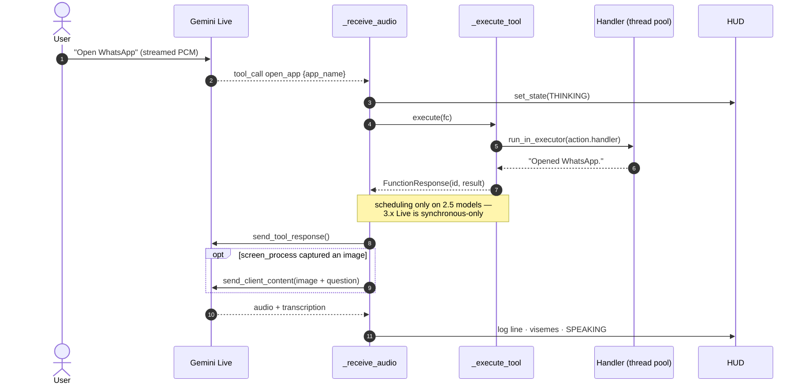
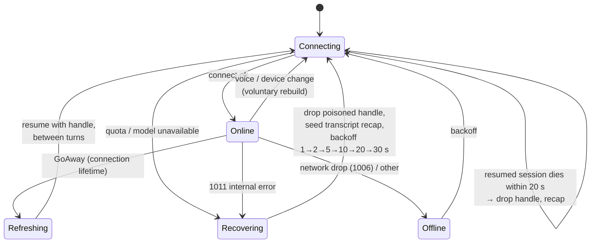
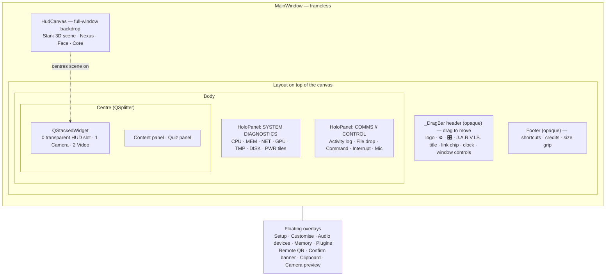
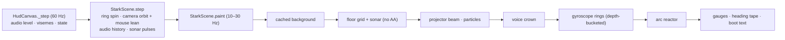
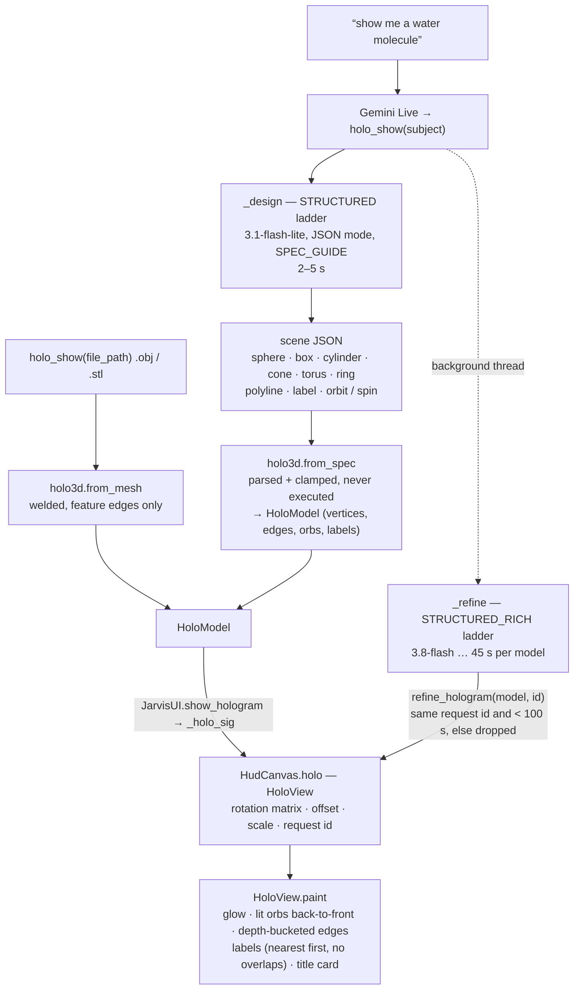
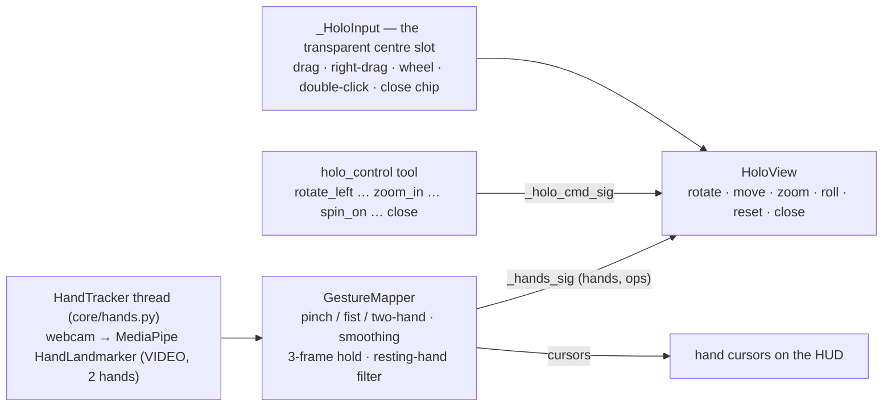

# MARK LV — Architecture

> **Maintained by Gowni Vamshi** · based on [MARK LV](https://github.com/FatihMakes/Mark-LV) by FatihMakes (CC BY-NC 4.0)

This document shows how the assistant is put together: the processes and
threads it runs, how audio and tool calls flow through it, and how a Live
session survives the server dropping it. The diagrams are [Mermaid](https://mermaid.js.org/)
and render directly on GitHub; an ASCII version of the overview comes first for
reading in a terminal.

---

## 1. The big picture

```text
                ┌──────────────────────────────── YOUR COMPUTER ─────────────────────────────────┐
                │                                                                                │
  🎤 Mic ──────▶│  sounddevice ──▶ EchoGuard / Wake word / PTT gate ──▶ out_queue ─┐             │
                │                                                                  │             │
  🔊 Speakers ◀─│  RawOutputStream ◀── audio_in_queue ◀──┐                         ▼             │       ┌────────────────────┐
                │        │ visemes / level               │                ┌─────────────────┐    │  WSS  │  Gemini Live API   │
                │        ▼                               └────────────────│   JarvisLive    │◀───┼──────▶│  gemini-3.8-live   │
                │  ┌───────────────┐   Qt signals    ┌────────────┐       │  (main.py,      │    │       │  (stable)          │
                │  │  PyQt6 HUD    │◀───────────────▶│ JarvisUI   │◀─────▶│   asyncio loop) │    │       └────────────────────┘
                │  │  (ui.py)      │                 │  facade    │       └───────┬─────────┘    │       ┌────────────────────┐
                │  │ Nexus · Face  │                 └────────────┘               │ tool calls   │ HTTPS │ Gemini REST models │
                │  │ · Core        │                                              ▼              │◀─────▶│ (one-shot ladder,  │
                │  └───────────────┘                      ┌────────────────────────────────────┐ │       │  core/gemini.py)   │
                │                                         │ Inline tools │ actions/*.py │ plugins│ │       └────────────────────┘
                │  📱 Phone ◀── HTTPS :8000 ──▶ Dashboard │ (vision,     │ (open_app,   │ (drop- │ │
                │               (FastAPI)  commands/audio │  memory, …)  │  files, web…)│  in)   │ │
                │                                         └──────────────┬─────────────────────┘ │
                │                         memory/long_term.json ◀────────┘  config/api_keys.json │
                └────────────────────────────────────────────────────────────────────────────────┘
```



---

## 2. Threads and tasks

The app runs two long-lived threads. Qt owns the main thread; everything that
talks to Gemini runs on one asyncio loop in a daemon thread. They only meet
through `JarvisUI`, whose methods emit Qt signals, so no widget is ever touched
from the wrong thread.



If any task in the group raises, the whole group is torn down and `run()`
decides what to do next (see §5). One failure path covers every way a session
can end.

---

## 3. Audio pipeline



* **Echo tail.** `stream.write()` returns before the sound has left the
  speakers, so for `output latency + 250 ms` after speaking the microphone is
  filtered by `core/echo.py`: blocks that match the assistant's own voice are dropped, and
  a real reply still gets through.
* **Visemes.** `_pcm_visemes()` reads F1/F2 formant energy from each 20 ms of
  outgoing audio. That drives the face's mouth, the Nexus sphere's ripple and the
  waveform, all from one source so they stay in sync.

---

## 4. A tool call, end to end



Tools come from three registries, checked in this order:

| Registry | Where | How it's found |
|---|---|---|
| Inline | `TOOL_DECLARATIONS` in `main.py` | Tied to live-session state (vision, memory, shutdown) |
| Actions | `actions/*.py` | Any module exporting a `TOOL` dict (`core/action_loader.py`) |
| Plugins | `plugins/*.py` | Drop-in files, validated and crash-isolated (`core/plugin_loader.py`) |

Names can't collide: actions can't shadow inline tools, and plugins can't shadow either.

---

## 5. Session lifecycle and recovery

This is the part that changed most in this build. The Live server can end a
session in several ways, and each one now has its own way back.



**How each failure is handled**

| Failure | Detected by | What happens |
|---|---|---|
| `1011 Internal error encountered` | close code from the leaf exception | Resumption handle **dropped** (resuming replays the broken state). A fresh session starts with the last 24 turns in its system instruction. Gentle backoff if it repeats. |
| `1011 Resource has been exhausted` / 429 | `core/gemini.is_quota_error` | Step down the Live model ladder. |
| Resumed session dies within 20 s | connection age | Handle dropped, conversation carried over from the transcript. |
| `GoAway` from server | `response.go_away` | Rebuild on the resumption handle at the next quiet moment, before the deadline. |
| Voice change | `_ReconnectSignal(keep_context=False)` | New session (the voice is fixed at connect), with the conversation seeded from the transcript. |
| Bad API key | `api key not valid` | Setup screen reopens and the app waits for a new key. |
| Unsupported config field (1007/1008, INVALID_ARGUMENT) | leaf error text | Tuning knobs dropped first, then proactive audio. |
| Network drop (1006, timeouts) | close code / error text | Exponential backoff, up to 60 s. |

**Why "leaf" exceptions.** A session runs in a `TaskGroup`, so failures arrive
wrapped in an `ExceptionGroup` whose message is *"unhandled errors in a
TaskGroup"*. The old code matched keywords against that wrapper text, and
`"unhandled"` contains `"handle"`. So every failure after a resume looked like a
rejected resumption handle, and quota errors raised mid-session were never
recognised. `_leaf_errors()`, `_close_code()` and `_error_text()` in `main.py`
always look inside the group.

**Model-aware config.** `_live_caps(model)` returns what each Live
generation accepts, because the generations disagree, sometimes in opposite
directions. The live ladder is `gemini-3.8-live` → `gemini-3.1-flash-live-preview`
→ `gemini-2.5-flash-native-audio`, and `live_model` in the config can put another
model, such as `gemini-3.8-live-extended-thinking`, in front.

| Setting | 2.5 native-audio | 3.1 flash live | 3.8 live *(default)* |
|---|---|---|---|
| Proactive audio | ✅ configurable (`v1alpha`) | ❌ not supported | always on, and setting the field is an **error**, so it's never sent |
| Context-window compression | ✅ on | ❌ off by default (the identified 1011 trigger) | off by default (`auto`) |
| Thinking | `thinking_budget` | `thinking_level` | **no `thinking_config` allowed** (interleaved reasoning is built in) |
| Tool calls | `behavior` as declared | sync only, so `behavior`/`scheduling` are stripped | **async by default**, so every tool is declared `BLOCKING` (a tool that asks for `NON_BLOCKING` keeps it and gets `scheduling`) |

**Continuity across restarts and model changes.**

| Situation | Mechanism |
|---|---|
| App crash, kill or restart | `core/session_state.py` keeps the last 24 turns, the unanswered request and a clean-exit flag on disk. It's written atomically within 5 s of a change and touched every 30 s. The next launch seeds a **fresh** session from it and sends a `[RESUMED]` turn that asks before finishing anything left half-done. No morning briefing after a crash. |
| Why not the old resumption handle | Resuming a session killed mid-answer replayed that answer and sometimes stopped responding (measured on 3.8). Handles are used only for reconnects within one run. |
| Quota on the main model | Step down the Live ladder. The handle is model-specific, so the conversation crosses over through the transcript. A per-day 429 rests the model until midnight Pacific; others rest 5 → 10 → 20 → 40 → 60 min. |
| Main model recovers | `_watch_primary` checks every 30 s, probes the better model with one real turn, and switches back in a quiet moment with the transcript. |
| New API key | `core/gemini.api_key()` re-reads the file when it changes, and the setup screen merges the key into the config instead of replacing it. |

**3.8 resume quirk.** Right after a connection closes, 3.8 refuses a resume with
a 1011 for about 1.5 s (gemini-live-api-examples #60). Deliberate reconnects
therefore wait 2 s before resuming, and a resume refused at once is retried a
single time before falling back to a fresh session with the transcript.

---

## 6. UI composition

The HUD canvas is the **backdrop of the whole window**: one widget behind
everything else, sized to the window. The layout sits on top of it, with
opaque floating panels and an empty, transparent slot in the centre. The
canvas centres the scene on that slot (`area_provider`).



**Why the panels are opaque.** The scene repaints 20–30 times a second. Qt
skips everything under an opaque widget when it repaints the widget behind it.
With translucent header and footer bars, every frame also repainted fifteen
labels and buttons; now only the canvas and three empty containers repaint.
`HoloPanel` paints its glass look once into a cached pixmap.

**HUD styles.** These live in `HudCanvas`; the 🎛 HUD button cycles through them and the choice is saved as `hud_style`:

| Style | What it draws |
|---|---|
| `stark` *(default)* | `core/hud3d.py`, a 3D projection table. Seven gyroscope rings on different axes, an arc-reactor core, a perspective grid floor with a projector beam, drifting particles, an audio equalizer crown, floor sonar pulses, CPU/MEM arc gauges, a heading tape and a boot sequence. The camera orbits slowly and leans toward the mouse. |
| `nexus` | A 340-point Fibonacci sphere with orbit rings, a voice trail, a radar sweep and corner telemetry. |
| `face` | The original holographic head with formant-driven lip-sync and facial acting (`core/avatar.py`). |
| `core` | The original reactor core. |

Everything is drawn in software with `QPainter`, so no GPU or OpenGL is needed.
The Stark scene uses numpy for rotation and perspective projection, batches
geometry into depth buckets (near is bright and thick, far is faint), draws the
faint floor without antialiasing, and caches its background. That comes to
about 10 ms a frame, dropping to about 10 fps when the window isn't focused.



### Holograms

A hologram is a tool answer that lands on the canvas instead of in the log. It
is drawn by the same canvas over whichever HUD style is active. The scene is
dimmed (`StarkScene.focus`) while one is up.



Input reaches the same `HoloView` three ways. All of them change only its pose
on the Qt thread:



`HandTracker` owns the webcam only while hand control is on. While it does,
`hands.latest_frame()` gives the camera snapshot tool and the live camera panel
its frames, so they don't try to open the device a second time. Frames are
kept in memory only: one frame at a time, replaced by the next.

---

## 7. Module map

```mermaid
flowchart LR
    MAINPY["main.py"] --> UIPY["ui.py"]
    MAINPY --> CORE
    MAINPY --> MEMPKG
    MAINPY --> ACTS
    UIPY --> AVATAR["core/avatar.py<br/>core/avatar_mesh.py"]
    UIPY --> MEMPKG
    subgraph CORE["core/"]
        GEM["gemini.py — one-shot model ladder"]
        AL["action_loader.py"]
        PL["plugin_loader.py"]
        ECHO["echo.py"]
        VIS["viseme.py"]
        AD["audio_devices.py"]
        WW["wake_word.py"]
        HK["hotkey.py"]
        UNDO["undo.py"]
        CONF["confirm.py"]
        KF["known_folders.py — real Desktop / Downloads"]
        H3D["hud3d.py — Stark scene"]
        HOLO["holo3d.py — hologram models + view"]
        HANDS["hands.py — webcam gestures"]
        PROMPT["prompt.txt"]
    end
    subgraph MEMPKG["memory/"]
        MM["memory_manager.py"]
        CM["config_manager.py"]
    end
    subgraph ACTS["actions/"]
        A1["open_app · browser_control · file_controller"]
        A2["web_search · screen_processor · video_player"]
        A3["computer_settings · computer_control · desktop"]
        A4["reminder · weather_report · send_message · …"]
        A5["holo_show · holo_control"]
    end
    DASHB["dashboard/server.py"] --> MAINPY
```



---

## 8. Data on disk

| File | Contents | In git? |
|---|---|---|
| `config/api_keys.json` | Gemini key, OS, names, voice, colour, toggles, plugin settings | ❌ ignored |
| `config/certs/` | Self-signed TLS key and certificate for the phone dashboard | ❌ ignored |
| `memory/long_term.json` | What the assistant remembers about you, plus session summaries | ❌ ignored |
| `memory/session_state.json` | The last 24 lines of conversation, for continuing after a crash or restart | ❌ ignored |
| `models/hand_landmarker.task` | MediaPipe hand model, downloaded the first time hand control is switched on | ❌ ignored |
| `core/prompt.txt` | System-prompt template; `{tokens}` are filled in at connect | ✅ |
| `core/face_model.obj` | MediaPipe canonical face (Apache-2.0) | ✅ |
