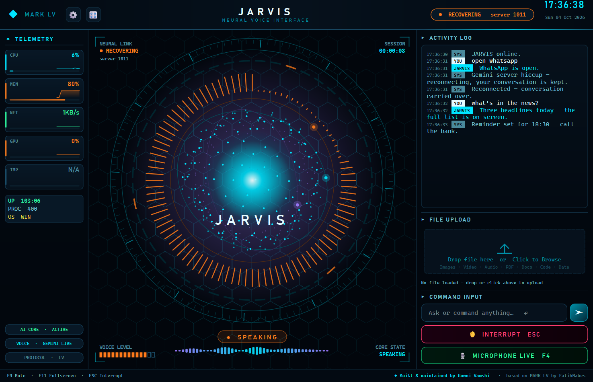

# ◆ MARK LV — Nexus Edition

### A real-time voice AI that can hear, see, speak and control your computer

**Built & maintained by Gowni Vamshi** · based on [MARK LV](https://github.com/FatihMakes/Mark-LV) by **FatihMakes** · [CC BY-NC 4.0](#-license--credits)

A desktop JARVIS-style assistant for Windows, macOS and Linux, built on the
**Gemini Live API** for native, low-latency speech. Talk to it, show it your
screen, and let it open apps, manage files, search the web, play video, set
reminders and more. There's no subscription; you only need a free Gemini API key.



> 📐 **How it works inside:** [ARCHITECTURE.md](ARCHITECTURE.md) has diagrams of the threads, audio pipeline, tool calls and session recovery.

---

## 🆕 What's new in this build

This branch adds three things on top of MARK LV: a fix for the Live session crash, a new HUD, and a round of correctness fixes.

### 🛡️ Stable Live sessions — the `1011 Internal error` crash is handled

The symptom: in the middle of a conversation, Gemini closed the WebSocket with
`1011 Internal error encountered`. The app reconnected *on the same resumption
handle*, crashed again within a second, and lost the conversation.

There were three causes, and each is fixed:

| Cause | Fix |
|---|---|
| **Resuming a poisoned session.** After a 1011 the server-side session is broken, and resuming replays the broken state ([reported upstream](https://discuss.ai.google.dev/t/live-api-gemini-3-1-flash-live-preview-audio-video-sessions-die-with-1011-internal-error-encountered-2-min-in/175234)). | After a 1011 the handle is **dropped** and a **fresh session is seeded with the last 24 turns**, so the conversation continues. Repeated failures back off gently (1 → 2 → 5 → 10 → 20 → 30 s) instead of looping. |
| **Unsupported config on `gemini-3.1-flash-live`.** The app sent proactive audio (`v1alpha`), `thinking_budget`, async-tool `scheduling` and context-window compression. Per Google's model page, 3.1 Live supports none of the first three, and Google staff identified **compression as a 1011 trigger**. | Config is now **model-aware**: on 3.x the unsupported fields are left out, `v1beta` is used, thinking uses `thinking_level`, and compression is **off by default** (configurable). 2.5 models keep everything they support. |
| **Error handling read the wrong text.** Failures arrive wrapped in a TaskGroup `ExceptionGroup` ("*unhandled errors…*"). The code matched `"handle"` inside **"un*handle*d"**, so every post-resume failure looked like a rejected handle, and quota errors raised mid-session were never recognised. | All checks now read the **leaf exceptions and the WebSocket close code** (`_leaf_errors`, `_close_code`). |

Also added:

* **GoAway handling.** When the server announces the connection is ending, the link is rebuilt in the next quiet moment instead of being cut mid-sentence.
* **Voice changes keep the conversation.** It's carried over from the transcript instead of being wiped.
* **Typed messages wait during a reconnect.** They're sent once the link is back, instead of silently disappearing.
* **Calm logging.** One line per dropped connection instead of a 60-line traceback. Set `JARVIS_DEBUG=1` to get full tracebacks back.
* **A live link indicator** in the header and HUD: `ONLINE` / `CONNECTING` / `RECOVERING` / `OFFLINE`.

### 🎨 The Nexus UI

| | |
|---|---|
| ✦ **Nexus HUD** *(new default)* | A 340-point holographic sphere that ripples with the voice and assembles itself on boot. Around it: tilted orbit rings with satellites, a segmented ring that chases while thinking, a radial **voice trail** (the last 1.6 s of audio), a radar sweep, a hex-lattice backdrop, and live corner telemetry (link, session timer, voice meter, state). |
| 📊 **Telemetry tiles** | CPU, MEM, NET, GPU and TMP, each with a one-minute **sparkline**, a severity accent and a gradient bar. |
| 💬 **Activity log** | Timestamped entries with coloured speaker badges (`YOU`, `JARVIS`, `SYS`, `NET`, `ERR`, `FILE`, `WEB`) and a typewriter effect that speeds up for long answers. |
| 🧭 **Header** | Logo mark, letter-spaced title, live link chip with the active model, clock, and an animated scan line. |
| 🔤 **Typography** | Cascadia Code / Bahnschrift with cross-platform fallbacks, replacing Courier New everywhere. |
| 🎛 **Three HUD styles** | 🎛 → HUD cycles **Nexus → Animated face → Reactor core**. The choice is saved. |

Everything is still drawn in software with `QPainter`, so you don't need a GPU. The
Nexus sphere renders in about 5 ms per frame, and idle repaint stays at around 20 Hz.

### 🩹 Correctness fixes

* **`open_app` claimed to open files that don't exist.** The model guessed `C:\Users\Username\Desktop\…` and the tool answered "Opened". Paths are now checked on disk: real ones are opened directly, and missing ones are reported honestly with the real home folder. A blind Start-menu search is no longer reported as a confirmed launch.
* **The model invented paths.** The system prompt now includes the real home, Desktop, Downloads and Documents folders.
* **`pynvml` FutureWarning on every launch.** The deprecated `pynvml` package is replaced by `nvidia-ml-py` (which provides the same module), and the import is silenced for older installs.
* **`.gitignore` didn't protect secrets.** Git doesn't support trailing `# comments`, so `config/api_keys.json`, `config/certs/` (TLS private key) and `config/whatsapp_web/` were **not ignored**. Fixed.
* **The assistant name defaulted to `"JARVI    S"`** before the config loaded. Fixed.
* **`JarvisUI.glance()` never worked.** It referenced an attribute that didn't exist. Fixed.
* **Quota exhaustion delivered as a 1011** ("Resource has been exhausted") is now recognised, so the app steps down the model ladder.
* **A bare 1007 no longer counts as "invalid API key".** That reopened the setup screen when the real cause was an unsupported field.

---

## 🚀 Capabilities

| Feature | Description |
|---|---|
| 🎙️ Real-time voice | Low-latency conversation in any language via Gemini Live |
| ✦ Nexus / 🧑 Face / ◉ Core HUD | Three software-rendered centrepieces that react to state and voice |
| 👄 Real lip-sync | About 50 mouth shapes a second from audio formants and the transcript |
| 👁️ Visual awareness | Screen capture and webcam vision, labelled by source |
| 🖥️ System control | Apps, volume, brightness, Wi-Fi, shortcuts, windows and power, all by voice |
| 📂 Files | Read, summarise, move, rename and organise. Everything can be undone |
| 🌐 Web | Multi-mode search (news / research / price / compare), browser control |
| 📺 Video on the HUD | YouTube, local files or URLs play where the avatar is; muted until you ask |
| 🧠 Memory | Remembers you across sessions, with a panel to view and delete facts |
| ↩️ Undo | Reverses the assistant's own file and settings changes |
| ⚠️ Real confirmation | Shutdown, restart and Wi-Fi wait for a button press that the model can't fake |
| 🎙️ Wake word | Local "Hey Jarvis". No audio leaves the machine while it's asleep |
| 🎚️ Push-to-talk | Hold **Ctrl+Space** to talk |
| 🔇 Self-echo guard | Never answers its own last sentence |
| 🌅 Morning briefing | Greeting, time, yesterday's recap and live news |
| 🔔 Proactive check-ins | Time- and context-aware, with background topic monitoring |
| 📱 Remote dashboard | Control it from your phone over HTTPS, paired with a QR code |
| 🧩 Plugins | Drop a `.py` file into `plugins/` and it's available on the next launch |
| 🪜 Model ladder | One-shot calls fall through nine Gemini models when one is out of quota or down |
| 🎨 Live theming | Recolour the whole UI from a hue wheel |
| 📋 Clipboard intelligence | Copy text to get Translate / Summarise / Explain / Fix |

---

## ⚡ Quick start

```bash
git clone https://github.com/FatihMakes/Mark-LV.git
cd Mark-LV
git checkout feature/stability-and-ui-overhaul   # this build
python setup.py        # installs dependencies for YOUR OS + Playwright browsers
python main.py
```

Paste your free [Gemini API key](https://aistudio.google.com/app/apikey) when the setup screen appears.

**Upgrading an existing install?** Swap the deprecated GPU package once:

```bash
pip uninstall -y pynvml
pip install -r requirements.txt
```

### Requirements

| | |
|---|---|
| **OS** | Windows 10/11, macOS or Linux |
| **Python** | 3.11 – 3.13 |
| **Hardware** | Microphone and speakers. No GPU needed |
| **API key** | Free Gemini API key, stored in `config/api_keys.json` |
| **Optional** | `yt-dlp` for YouTube on the HUD (installed by setup); `openwakeword` for the wake word (one click in ⚙) |

---

## ⚙️ Configuration

Settings live in `config/api_keys.json`, and most of them can be changed from the UI.
These are the advanced keys:

| Key | Default | What it does |
|---|---|---|
| `hud_style` | `"nexus"` | `nexus`, `face` or `core`. Cycle with 🎛 → HUD |
| `context_compression` | `"auto"` | `auto` = off on Gemini 3.x Live (avoids 1011s), on for 2.5. Use `true` or `false` to force it |
| `thinking_enabled` | `false` | Lets the Live model reason before answering (uses `thinking_level` on 3.x) |
| `proactive_audio` | `true` | 2.5 native-audio only. Ignored on 3.x, which doesn't support it |
| `turn_tuning` | off | `{"enabled": true, "silence_ms": 550, ...}` sets how quickly your turn ends |
| `media_resolution` | `"medium"` | Token resolution for screenshots and camera frames |
| `voice_name` | `"Charon"` | `Charon`, `Puck`, `Kore`, `Fenrir` or `Aoede` |

| Environment variable | Effect |
|---|---|
| `JARVIS_DEBUG=1` | Prints full tracebacks for dropped connections and errors |

---

## 🩺 Troubleshooting

| You see | Meaning | Action |
|---|---|---|
| `⚠ Gemini closed the session with 1011 …` | A Google-side error | None. The app reconnects with your conversation kept. If it repeats constantly, the service may be having an outage |
| Header chip shows `RECOVERING` | Reconnecting after a server or quota error | Wait a few seconds |
| `Resumption handle rejected` | The old session couldn't be resumed | None. It continues in a fresh session seeded from the transcript |
| `[Audio] output: host API reports success but moves no audio … skipping it` | The startup probe found a silent audio backend (usually DirectSound output) and skipped it | None. This is expected; it picks a working one (MME) |
| `FutureWarning: The pynvml package is deprecated` | An old install still has `pynvml` | `pip uninstall -y pynvml` |
| `API key invalid` and the setup screen reopens | Wrong or revoked key | Paste a valid key |

---

## 🗂️ Project structure

```text
Mark-LV/
├── main.py              # Live session lifecycle, audio I/O, tool dispatch, recovery
├── ui.py                # PyQt6 interface — Nexus/Face/Core HUD, telemetry, log, drawers
├── ARCHITECTURE.md      # Diagrams: threads, audio, tools, recovery, UI, modules
├── setup.py             # OS-aware installer
├── requirements.txt
├── actions/             # Bundled skills — each exports a TOOL dict, auto-discovered
├── plugins/             # Drop-in skills (_template.py shows the shape)
├── core/                # gemini ladder, loaders, echo guard, visemes, avatar, wake word,
│                        # audio devices, undo, confirm gate, prompt.txt
├── memory/              # memory_manager (long_term.json), config_manager (api_keys.json)
├── dashboard/           # FastAPI phone remote + static pages
├── config/              # api_keys.json + certs/ (both git-ignored)
└── docs/
    └── RELEASE_NOTES.md # The original MARK LV release notes by FatihMakes
```

See [ARCHITECTURE.md](ARCHITECTURE.md) for how these fit together.

---

## 🔒 Your data

Everything stays on your machine. There's no server, telemetry or account.

| What | Where | Notes |
|---|---|---|
| Gemini key, plugin credentials | `config/api_keys.json` | **Plaintext.** Treat it like a password file |
| Dashboard TLS key and certificate | `config/certs/` | Self-signed and generated locally |
| What the assistant remembers | `memory/long_term.json` | Delete it to make the assistant forget everything |

All three are git-ignored (this build fixed the rules that silently didn't
work). **If you ever pushed `config/api_keys.json` anywhere, revoke the key** at
[aistudio.google.com](https://aistudio.google.com/app/apikey). Deleting it in a
later commit doesn't remove it from the history.

Your voice is streamed to Google's Gemini Live API while a session is open. The
stream stops when you mute or close the app.

---

## ⚖️ License & credits

* **Original project:** MARK LV © 2026 **FatihMakes**: [github.com/FatihMakes/Mark-LV](https://github.com/FatihMakes/Mark-LV) · [YouTube @FatihMakes](https://www.youtube.com/@FatihMakes)
* **This build:** stability fixes, the Nexus UI, the architecture docs and the changes listed above, by **Gowni Vamshi**
* **License:** [Creative Commons BY-NC 4.0](https://creativecommons.org/licenses/by-nc/4.0/) (see [LICENSE](LICENSE)). Personal and non-commercial use only. Keep this attribution when you share it.
* **Third-party asset:** `core/face_model.obj`, the MediaPipe canonical face model (Apache-2.0)
