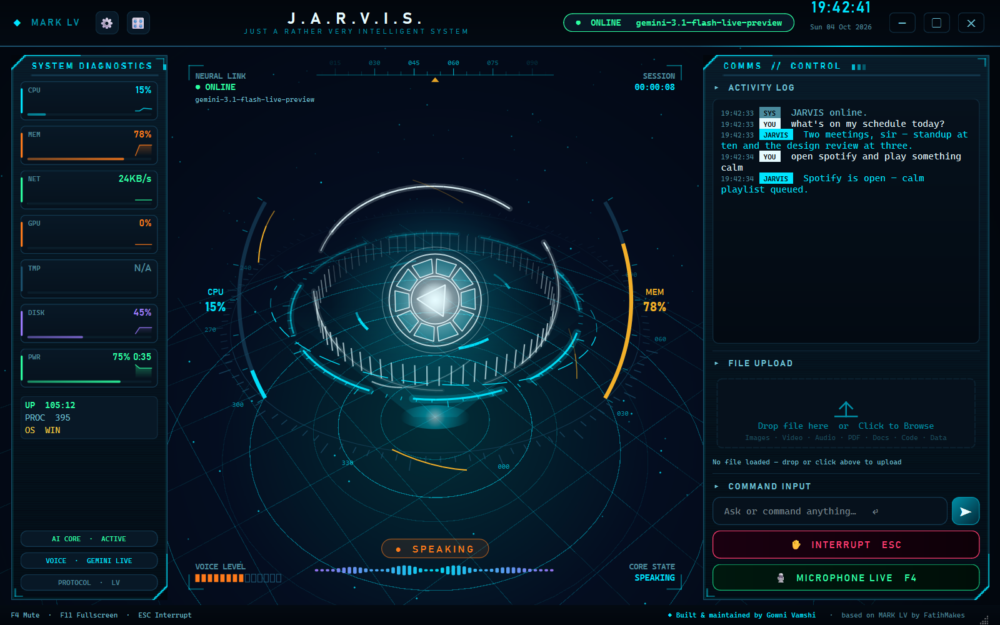

# ◆ MARK LV — Stark Edition

### A real-time voice AI that can hear, see, speak and control your computer

**Built & maintained by Gowni Vamshi** · based on [MARK LV](https://github.com/FatihMakes/Mark-LV) by **FatihMakes** · [CC BY-NC 4.0](#-license--credits)

A desktop JARVIS-style assistant for Windows, macOS and Linux, built on the
**Gemini Live API** for native, low-latency speech. Talk to it, show it your
screen, and let it open apps, manage files, search the web, play video, set
reminders and more. There's no subscription; you only need a free Gemini API key.



> 📐 **How it works inside:** [ARCHITECTURE.md](ARCHITECTURE.md) has diagrams of the threads, audio pipeline, tool calls and session recovery.

---

## 🆕 What's new in this build

This branch adds three things on top of MARK LV: a fix for the Live session crash, a 3D Iron Man-style interface, and a round of correctness fixes.

### 🛡️ Stable Live sessions — the `1011 Internal error` crash is handled

The symptom: in the middle of a conversation, Gemini closed the WebSocket with
`1011 Internal error encountered`. The app reconnected *on the same resumption
handle*, crashed again within a second, and lost the conversation.

There were three causes, and each is fixed:

| Cause | Fix |
|---|---|
| **Resuming a poisoned session.** After a 1011 the server-side session is broken, and resuming replays the broken state ([reported upstream](https://discuss.ai.google.dev/t/live-api-gemini-3-1-flash-live-preview-audio-video-sessions-die-with-1011-internal-error-encountered-2-min-in/175234)). | After a 1011 the handle is **dropped** and a **fresh session is seeded with the last 24 turns**, so the conversation continues. Repeated failures back off gently (1 → 2 → 5 → 10 → 20 → 30 s) instead of looping. |
| **Unsupported config on `gemini-3.1-flash-live`.** The app sent proactive audio (`v1alpha`), `thinking_budget`, async-tool `scheduling` and context-window compression. Per Google's model page, 3.1 Live supports none of the first three, and Google staff identified **compression as a 1011 trigger**. | Config is now **model-aware**: on 3.x the unsupported fields are left out, `v1beta` is used, thinking uses `thinking_level`, and compression is **off by default** (configurable). 2.5 models keep everything they support. |
| **Error handling read the wrong text.** Failures arrive wrapped in a TaskGroup `ExceptionGroup` ("*unhandled errors…*"). The code matched `"handle"` inside **"un*handle*d"**, so every post-resume failure looked like a rejected handle, and quota errors raised mid-session were never recognised. | All checks now read the **leaf exceptions and the WebSocket close code** (`_leaf_errors`, `_close_code`). |

Also added:

* **GoAway handling.** When the server announces the connection is ending, the link is rebuilt in the next quiet moment instead of being cut mid-sentence.
* **Voice changes keep the conversation.** It's carried over from the transcript instead of being wiped.
* **Typed messages wait during a reconnect.** They're sent once the link is back, instead of silently disappearing.
* **Calm logging.** One line per dropped connection instead of a 60-line traceback. Set `JARVIS_DEBUG=1` to get full tracebacks back.
* **A live link indicator** in the header and HUD: `ONLINE` / `CONNECTING` / `RECOVERING` / `OFFLINE`.

### 🧠 Upgraded to the newest Gemini models

Picked from the models **this API key actually offers** (`models.list`) and
ordered by **measured** speed, not by version number:

| Job | Model | Why |
|---|---|---|
| Voice conversation | **`gemini-3.8-live`** (stable) | Newest Live model. Measured first audio in 1.2–1.6 s with a tool call, against 1.4–6.9 s on 3.1. |
| Backup voices | `gemini-3.1-flash-live-preview` → `gemini-2.5-flash-native-audio` | Used automatically on quota or outage. |
| Reasoning, code, summaries | **`gemini-3.8-flash`** leads | Newest text model. |
| Quick replies, JSON | `gemini-3.1-flash-lite` leads | Fastest clean JSON (about 1 s). |
| Scanned PDFs | `gemini-2.5-flash-lite` → `gemini-3.1-flash-lite` | 9–12 s. 3.8-flash took 75 s, too slow inside a voice turn. |
| Web search with sources | `gemini-2.5-flash` | 3.8-flash has no search quota on the free tier (429). It stays in the chain for paid keys. |

3.8-live needed real changes:
- Every tool is declared `BLOCKING`, because 3.8 defaults to async calls.
- `thinking_config` is never sent; 3.8 rejects it.
- Proactive audio is left to the model; 3.8 has it always on and rejects the setting.
- 3.8 sometimes refuses a resume for about 1.5 s after a reconnect, so the app waits 2 s and retries once before falling back to a fresh session.

Verified end to end on 3.8 with real speech: resume, fresh session and 1011 recovery all answered correctly.

### 🦾 The Stark UI — a 3D J.A.R.V.I.S. interface

The whole window is now a holographic projection table in the style of the Iron
Man films. A small software 3D engine (`core/hud3d.py`) renders the scene;
the panels float over it as holographic glass.

| | |
|---|---|
| 🌀 **3D gyroscope** | Seven rings turning on different axes around the core. Some are segmented, some dashed, some carry tick marks and degree labels. A perspective camera orbits slowly and leans toward your mouse. |
| ⚛️ **Arc reactor core** | Ten coil segments, the triangle element and a hot centre that swells with the voice. |
| 🟦 **Projection table** | A grid floor receding to the horizon, a projector beam rising to the core, particles drifting through the volume, and sonar rings that roll across the floor while it speaks. |
| 🎚️ **Voice crown** | An equalizer standing up around the core, driven by the real audio. |
| 🎯 **Helmet HUD overlays** | CPU and memory arc gauges flanking the core, a heading tape across the top, and corner read-outs (neural link, session timer, voice level, core state). |
| 🎨 **State is colour** | Cyan when listening, white-hot when speaking, gold when thinking, amber when recovering, red when muted. |
| 🚀 **Boot sequence** | "INITIALISING J.A.R.V.I.S." with the rings drawing themselves in, then "ALL SYSTEMS ONLINE". |
| 🪟 **Floating glass panels** | Chamfered corners, glowing edges and title tabs: **System Diagnostics** (now with disk and battery) and **Comms // Control**. |
| 🖥️ **Frameless window** | The header is the title bar: drag to move (with Windows snapping), double-click to maximise, and window controls top-right. Resize from the bottom-right grip; F11 for fullscreen. |

**Performance:** about 10–12 ms per frame on a laptop CPU, the same as the original animated face. The rate drops to about 10 fps when the window isn't focused, unless the assistant is speaking. The panels are opaque on purpose, so Qt never repaints them along with the scene.

### 🎨 Also in the UI

| | |
|---|---|
| ✦ **Nexus HUD** | A 340-point holographic sphere that ripples with the voice and assembles itself on boot. Around it: tilted orbit rings with satellites, a segmented ring that chases while thinking, a radial **voice trail** (the last 1.6 s of audio), a radar sweep, a hex-lattice backdrop, and live corner telemetry (link, session timer, voice meter, state). |
| 📊 **Telemetry tiles** | CPU, MEM, NET, GPU and TMP, each with a one-minute **sparkline**, a severity accent and a gradient bar. |
| 💬 **Activity log** | Timestamped entries with coloured speaker badges (`YOU`, `JARVIS`, `SYS`, `NET`, `ERR`, `FILE`, `WEB`) and a typewriter effect that speeds up for long answers. |
| 🧭 **Header** | Logo mark, letter-spaced title, live link chip with the active model, clock, and an animated scan line. |
| 🔤 **Typography** | Cascadia Code / Bahnschrift with cross-platform fallbacks, replacing Courier New everywhere. |
| 🎛 **Four HUD styles** | 🎛 → HUD cycles **Stark 3D → Nexus → Animated face → Reactor core**. The choice is saved. |

Everything is still drawn in software with `QPainter`, so you don't need a GPU. The
Nexus sphere renders in about 5 ms per frame, and idle repaint stays at around 20 Hz.

### 🩹 Correctness fixes

* **`open_app` claimed to open files that don't exist.** The model guessed `C:\Users\Username\Desktop\…` and the tool answered "Opened". Paths are now checked on disk: real ones are opened directly, and missing ones are reported honestly with the real home folder. A blind Start-menu search is no longer reported as a confirmed launch.
* **The model invented paths.** The system prompt now includes the real home, Desktop, Downloads and Documents folders.
* **`pynvml` FutureWarning on every launch.** The deprecated `pynvml` package is replaced by `nvidia-ml-py` (which provides the same module), and the import is silenced for older installs.
* **`.gitignore` didn't protect secrets.** Git doesn't support trailing `# comments`, so `config/api_keys.json`, `config/certs/` (TLS private key) and `config/whatsapp_web/` were **not ignored**. Fixed.
* **The assistant name defaulted to `"JARVI    S"`** before the config loaded. Fixed.
* **`JarvisUI.glance()` never worked.** It referenced an attribute that didn't exist. Fixed.
* **Quota exhaustion delivered as a 1011** ("Resource has been exhausted") is now recognised, so the app steps down the model ladder.
* **A bare 1007 no longer counts as "invalid API key".** That reopened the setup screen when the real cause was an unsupported field.
* **Moved Desktop / Downloads folders are respected.** About 15 places assumed `C:\Users\<you>\Desktop`. On machines where Windows or OneDrive has moved these folders (for example `E:\desktop`), "list my downloads" showed the wrong folder, saved files landed somewhere you never look, and the real Desktop was "Access denied". A new `core/known_folders.py` asks the Windows shell (or XDG on Linux) where the folders really are, and the whole app uses it.
* **Folder lookups recover instead of dead-ending.** A path built on the default layout is remapped to the real folder automatically. A miss now returns the closest real names ("did you mean …"), and `find` matches folders as well as files.
* **Scanned and image-only PDFs can be read.** Lecture slides exported as pictures used to stop at "may be scanned". The PDF is now sent to Gemini, which reads the page images (OCR included); this takes about 8–10 s for a 6-page lecture.
* **Telugu, Hindi, Tamil, Bengali and other scripts render properly**, and the console no longer fills with `qt.text.font.db: OpenType support missing…` lines.
* **The assistant no longer goes silent after a new session.** Tested with real voice against the live server: after a reconnect it could get stuck calling `recall_memory` over and over (more than 60 times) without ever answering. Three fixes:
  - Memory search failed on the model's own `snake_case` keys, so facts it had just saved came back "Nothing stored".
  - A miss now says the search is final.
  - A loop guard stops repeated or runaway tool calls and tells the model to answer.
* **Cleaner session switches.**
  - Teardown no longer freezes the event loop for 300–400 ms while buffered audio plays out.
  - A stale GoAway refresh can no longer tear down the *next* session.
  - Wake-word mode no longer falls asleep on every reconnect.
  - The startup news briefing is skipped if you start talking first, instead of landing on top of your request.
* **Closing the window is no longer silent.** It prints `Window closed`, saves the conversation summary that used to be lost, and `faulthandler` reports a real crash if one ever happens. Ctrl+C in the terminal now closes the app properly.

---

## 🚀 Capabilities

| Feature | Description |
|---|---|
| 🎙️ Real-time voice | Low-latency conversation in any language via Gemini Live |
| ✦ Nexus / 🧑 Face / ◉ Core HUD | Three software-rendered centrepieces that react to state and voice |
| 👄 Real lip-sync | About 50 mouth shapes a second from audio formants and the transcript |
| 👁️ Visual awareness | Screen capture and webcam vision, labelled by source |
| 🖥️ System control | Apps, volume, brightness, Wi-Fi, shortcuts, windows and power, all by voice |
| 📂 Files | Read, summarise, move, rename and organise. Everything can be undone |
| 🌐 Web | Multi-mode search (news / research / price / compare), browser control |
| 📺 Video on the HUD | YouTube, local files or URLs play where the avatar is; muted until you ask |
| 🧠 Memory | Remembers you across sessions, with a panel to view and delete facts |
| ↩️ Undo | Reverses the assistant's own file and settings changes |
| ⚠️ Real confirmation | Shutdown, restart and Wi-Fi wait for a button press that the model can't fake |
| 🎙️ Wake word | Local "Hey Jarvis". No audio leaves the machine while it's asleep |
| 🎚️ Push-to-talk | Hold **Ctrl+Space** to talk |
| 🔇 Self-echo guard | Never answers its own last sentence |
| 🌅 Morning briefing | Greeting, time, yesterday's recap and live news |
| 🔔 Proactive check-ins | Time- and context-aware, with background topic monitoring |
| 📱 Remote dashboard | Control it from your phone over HTTPS, paired with a QR code |
| 🧩 Plugins | Drop a `.py` file into `plugins/` and it's available on the next launch |
| 🪜 Model ladder | One-shot calls fall through nine Gemini models when one is out of quota or down |
| 🎨 Live theming | Recolour the whole UI from a hue wheel |
| 📋 Clipboard intelligence | Copy text to get Translate / Summarise / Explain / Fix |

---

## ⚡ Quick start

```bash
git clone https://github.com/FatihMakes/Mark-LV.git
cd Mark-LV
git checkout feature/stability-and-ui-overhaul   # this build
python setup.py        # installs dependencies for YOUR OS + Playwright browsers
python main.py
```

Paste your free [Gemini API key](https://aistudio.google.com/app/apikey) when the setup screen appears.

**Upgrading an existing install?** Swap the deprecated GPU package once:

```bash
pip uninstall -y pynvml
pip install -r requirements.txt
```

### Requirements

| | |
|---|---|
| **OS** | Windows 10/11, macOS or Linux |
| **Python** | 3.11 – 3.13 |
| **Hardware** | Microphone and speakers. No GPU needed |
| **API key** | Free Gemini API key, stored in `config/api_keys.json` |
| **Optional** | `yt-dlp` for YouTube on the HUD (installed by setup); `openwakeword` for the wake word (one click in ⚙) |

---

## ⚙️ Configuration

Settings live in `config/api_keys.json`, and most of them can be changed from the UI.
These are the advanced keys:

| Key | Default | What it does |
|---|---|---|
| `hud_style` | `"stark"` | `stark`, `nexus`, `face` or `core`. Cycle with 🎛 → HUD |
| `context_compression` | `"auto"` | `auto` = off on Gemini 3.x Live (avoids 1011s), on for 2.5. Use `true` or `false` to force it |
| `live_model` | *(unset)* | Put a specific Live model first, e.g. `gemini-3.8-live-extended-thinking` for deeper reasoning (slower first word) |
| `thinking_enabled` | `false` | Lets 2.5 / 3.1 Live models reason before answering. 3.8 reasons on its own and ignores this. |
| `proactive_audio` | `true` | 2.5 native-audio only. Ignored on 3.x, which doesn't support it |
| `turn_tuning` | off | `{"enabled": true, "silence_ms": 550, ...}` sets how quickly your turn ends |
| `media_resolution` | `"medium"` | Token resolution for screenshots and camera frames |
| `voice_name` | `"Charon"` | `Charon`, `Puck`, `Kore`, `Fenrir` or `Aoede` |

| Environment variable | Effect |
|---|---|
| `JARVIS_DEBUG=1` | Prints full tracebacks for dropped connections and errors |

---

## 🩺 Troubleshooting

| You see | Meaning | Action |
|---|---|---|
| `⚠ Gemini closed the session with 1011 …` | A Google-side error | None. The app reconnects with your conversation kept. If it repeats constantly, the service may be having an outage |
| Header chip shows `RECOVERING` | Reconnecting after a server or quota error | Wait a few seconds |
| `Resumption handle rejected` | The old session couldn't be resumed | None. It continues in a fresh session seeded from the transcript |
| `[Audio] output: directsound accepts audio but never plays it …` | The startup probe found a silent audio backend and skipped it | None. This is expected on Windows; it picks a working one (MME) |
| Log ends without `Window closed` | The process died instead of being closed | Copy the `Fatal Python error` / traceback that `faulthandler` printed into a bug report |
| `[Gemini] …: ReadError … forcibly closed by the remote host` | The network dropped a request | None. The ladder retries on the next model. If it happens often, check your network or VPN |
| `FutureWarning: The pynvml package is deprecated` | An old install still has `pynvml` | `pip uninstall -y pynvml` |
| `API key invalid` and the setup screen reopens | Wrong or revoked key | Paste a valid key |

---

## 🗂️ Project structure

```text
Mark-LV/
├── main.py              # Live session lifecycle, audio I/O, tool dispatch, recovery
├── ui.py                # PyQt6 interface — Nexus/Face/Core HUD, telemetry, log, drawers
├── ARCHITECTURE.md      # Diagrams: threads, audio, tools, recovery, UI, modules
├── setup.py             # OS-aware installer
├── requirements.txt
├── actions/             # Bundled skills — each exports a TOOL dict, auto-discovered
├── plugins/             # Drop-in skills (_template.py shows the shape)
├── core/                # gemini ladder, loaders, echo guard, visemes, avatar, wake word,
│                        # audio devices, undo, confirm gate, prompt.txt
├── memory/              # memory_manager (long_term.json), config_manager (api_keys.json)
├── dashboard/           # FastAPI phone remote + static pages
├── config/              # api_keys.json + certs/ (both git-ignored)
└── docs/
    └── RELEASE_NOTES.md # The original MARK LV release notes by FatihMakes
```

See [ARCHITECTURE.md](ARCHITECTURE.md) for how these fit together.

---

## 🔒 Your data

Everything stays on your machine. There's no server, telemetry or account.

| What | Where | Notes |
|---|---|---|
| Gemini key, plugin credentials | `config/api_keys.json` | **Plaintext.** Treat it like a password file |
| Dashboard TLS key and certificate | `config/certs/` | Self-signed and generated locally |
| What the assistant remembers | `memory/long_term.json` | Delete it to make the assistant forget everything |

All three are git-ignored (this build fixed the rules that silently didn't
work). **If you ever pushed `config/api_keys.json` anywhere, revoke the key** at
[aistudio.google.com](https://aistudio.google.com/app/apikey). Deleting it in a
later commit doesn't remove it from the history.

Your voice is streamed to Google's Gemini Live API while a session is open. The
stream stops when you mute or close the app.

---

## ⚖️ License & credits

* **Original project:** MARK LV © 2026 **FatihMakes**: [github.com/FatihMakes/Mark-LV](https://github.com/FatihMakes/Mark-LV) · [YouTube @FatihMakes](https://www.youtube.com/@FatihMakes)
* **This build:** stability fixes, the Nexus UI, the architecture docs and the changes listed above, by **Gowni Vamshi**
* **License:** [Creative Commons BY-NC 4.0](https://creativecommons.org/licenses/by-nc/4.0/) (see [LICENSE](LICENSE)). Personal and non-commercial use only. Keep this attribution when you share it.
* **Third-party asset:** `core/face_model.obj`, the MediaPipe canonical face model (Apache-2.0)
